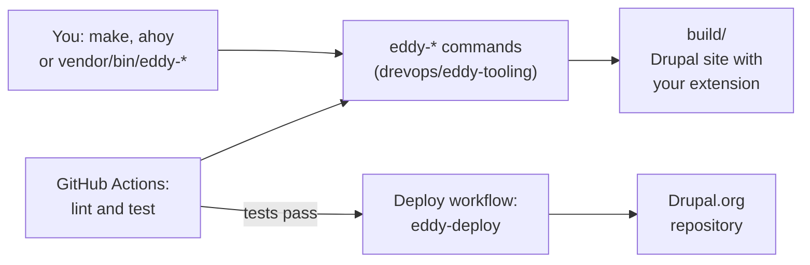

import CommandTabs from '@site/src/components/CommandTabs';

# Eddy

Eddy is a template for maintaining a contributed Drupal module or theme on GitHub. Start your extension from it and you get CI on GitHub Actions, a local Drupal site to develop and test against, coding standards checks and mirroring of the code to [Drupal.org](https://www.drupal.org).

You write the extension, and Eddy provides the rest. The commands that build the site on your machine are the same commands CI runs, so a run that passes locally is likely to pass in CI too.

:::info Building a website?

Eddy isn't for building websites: use [Vortex](https://www.vortextemplate.com) for that. The 2 templates do separate jobs, and a repository uses only 1 of them.

:::

## What you get

- ⚙️ **[CI on GitHub Actions](continuous-integration/README.mdx)** - PHP `8.3`, `8.4` and `8.5`, and Drupal `stable` on 10, 11 and 12, plus `legacy` and `canary` tiers on 11 and 12. [The version matrix](continuous-integration/README.mdx#the-version-matrix) explains the tiers. Code coverage comes from [pcov](https://github.com/krakjoe/pcov), and goes to [codecov.io](https://codecov.io) when you add a `CODECOV_TOKEN` repository secret. With 1 override, the setup works with [Drupal.org GitLab CI](continuous-integration/drupal-ci.mdx) too.
- 💻 **[Local development](development/README.mdx)** - a site built from [drupal/recommended-project](https://www.drupal.org/docs/develop/using-composer/starting-a-site-using-drupal-composer-project-templates) on the PHP of your host, by the same [tooling](development/tooling.mdx) commands that CI runs. You run them through `make`, [Ahoy](https://github.com/ahoy-cli/ahoy) or directly. The build sets up a module or a theme, adds the development dependencies from `composer.dev.json` and the extensions you `suggest`, and applies your [patches](development/dependencies.mdx#patch-dependencies).
- 🧹 **[Coding standards](development/coding-standards.mdx)** - PHPCS with the `Drupal`, `DrupalPractice`, `DrevOps` and `PHPCompatibility` standards, PHPStan with [PHPStan Drupal](https://github.com/mglaman/phpstan-drupal), [Drupal Rector](https://github.com/palantirnet/drupal-rector), [Twig CS Fixer](https://github.com/VincentLanglet/Twig-CS-Fixer), [ESLint](https://eslint.org/), [Stylelint](https://stylelint.io/), [CSpell](https://cspell.org/) and [Prettier](https://prettier.io/).
- 🧪 **[Tests](testing/README.mdx)** - PHPUnit Unit, Kernel, Functional and FunctionalJavascript tests, in a local Chrome or a Selenium container, and JavaScript tests with [Jest](https://jestjs.io/).
- 🚚 **[Deployment](deployment/README.mdx)** - mirroring of the code and its tags to Drupal.org, or any other git remote, after CI passes, optionally to a different destination branch.
- 🤖 **[Renovate](updating/renovate.mdx)** - grouped pull requests that keep npm packages, GitHub Actions and Docker images up to date. It leaves Composer packages for you to update by hand.
- 📝 **Docs for your extension** - `README.md` and `CONTRIBUTING.md` templates.

Eddy tests itself the way it tests a project created from it, and deploys to [drevops/eddy_destination](https://github.com/drevops/eddy_destination) as a working example.

## How it fits together

Your repository holds the extension and a few configuration files. The commands that assemble, run and deploy it come from the [`drevops/eddy-tooling`](development/tooling.mdx) package, and both your machine and CI call them:

## A quick look

[Installation](installation.mdx) covers every step, from the download to the first deployment. Each set of tabs on this site shows the commands for 1 setup: Make, Ahoy or no command wrapper. In a new, empty directory, the first run looks like this:

<CommandTabs
  make={`curl -fsSL https://eddy.drevops.com/install > install.php
php install.php   # Answer the questions about your extension
make build        # Assemble the codebase, start the server, install Drupal
make lint         # Check coding standards
make test         # Run the tests`}
  ahoy={`curl -fsSL https://eddy.drevops.com/install > install.php
php install.php   # Answer the questions about your extension
ahoy build        # Assemble the codebase, start the server, install Drupal
ahoy lint         # Check coding standards
ahoy test         # Run the tests`}
  none={`curl -fsSL https://eddy.drevops.com/install > install.php
php install.php               # Answer the questions about your extension
scripts/eddy-tooling          # Install the tooling
vendor/bin/eddy-assemble      # Assemble the codebase
vendor/bin/eddy-start         # Start the PHP server
vendor/bin/eddy-provision     # Install Drupal
# Lint and test with the commands that your CONTRIBUTING.md lists.`}
/>

## Where to next

- New to Eddy? Start with [Installation](installation.mdx).
- Working on an extension that already uses Eddy? [Development](development/README.mdx) covers the daily commands.
- On an older Eddy release? [Update your extension](updating/README.mdx) brings it up to date, and [Upgrade a 4.x project to 5.x](updating/upgrading-from-4x.mdx) covers the move from 4.x.
- Looking for examples? The [projects using Eddy](/#projects-using-eddy) are on the home page.
