# Deployment

After the tests pass, CI mirrors the code to a destination repository: your extension's repository on Drupal.org, or any other git remote. You develop on GitHub, and CI does the pushing to Drupal.org for you. This page explains what deploys, the order that deployments run in and what turns deployment on.

[drevops/eddy_destination](https://github.com/drevops/eddy_destination) shows a destination repository at work: Eddy deploys itself there the same way.

## What deploys

CI deploys pushes to the branches in the `push` filter of `.github/workflows/test.yml`, which the installer sets to `1.x` or to the branches in `INSTALL_BRANCHES` (see [What the installer changes](../installation.mdx#what-the-installer-changes)), and each tag whose own `Test` run passes. A branch deployment also pushes every other tag, as the following list explains. Pull requests never deploy. To deploy another branch, such as `2.x`, add it to that filter. Updating the scaffold with the [`update-consumer-eddy`](../updating/README.mdx) skill keeps the branches you list there.

```mermaid
flowchart TB
  push["Push to a branch<br/>or a tag"] --> test["Test workflow"]
  test -->|passes| deploy["Deploy workflow"]
  deploy --> kind{"Tag or branch?"}
  kind -->|tag| tag["Push the tag alone"]
  kind -->|branch| tip{"Still the tip<br/>of the branch?"}
  tip -->|yes| branch["Push the branch<br/>and the tags"]
  tip -->|no| skip["Skip with a notice"]
```

The 2 kinds of push deploy differently:

- **A branch push** force-pushes the commit that CI tested to the branch of the same name in the destination repository. The first deployment of a branch creates it there. It then force-pushes every tag of the repository too, so a tag whose own `Test` run failed still reaches the destination with the next branch deployment.
- **A tag** is deployed as that tag alone and leaves the destination branches untouched, so a tag behind a branch's tip can't rewind the branch.

To send the branches to a destination branch of another name, set the `DEPLOY_BRANCH` repository variable to it, such as `1.x` when you develop on `main` and have added `main` to the `push` filter. It applies to every branch that deploys, while tags stay tags.

## Deployment order

Each deployment of a branch waits for the previous one, then checks the branch on GitHub right before it pushes. When the tested commit is no longer the tip of the branch, it skips the deployment with a notice, and the run passes. That happens after a newer push, and when you re-run the `Test` or `Deploy` run of an older commit, so an older commit of the branch never replaces a newer one. Deployments of different branches don't wait for each other, even when `DEPLOY_BRANCH` sends them to the same destination branch.

## Turn on deployment

CI pushes with an SSH key, and reads its settings from repository secrets and the optional `DEPLOY_BRANCH` variable. The `Deploy` workflow checks the secrets in this order:

1. Without `DEPLOY_REMOTE`, it reports a notice and skips its other steps, so the run passes.
2. Without `DEPLOY_SSH_KEY`, `DEPLOY_USER_NAME` or `DEPLOY_USER_EMAIL`, it fails.
3. Without the `DEPLOY_PROCEED` secret set to `1`, it stops before the push with "Skip deployment because DEPLOY_PROCEED is not set to 1." and passes, which lets you test it first.

With all 5 secrets set, the workflow pushes.

[Set up deployment](setup.mdx) walks through the key and the secrets.
