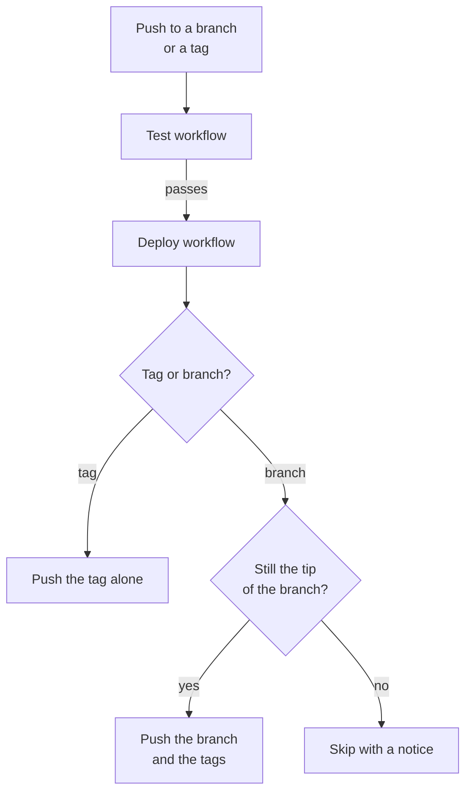

# Deployment

After the tests pass, CI mirrors the code to your extension's Drupal.org repository, or any other git remote. You develop on GitHub, and Drupal.org gets every tested commit and tag without a manual push. This page explains what deploys, the order that deployments run in and what turns deployment on.

[drevops/eddy_destination](https://github.com/drevops/eddy_destination) shows a destination repository at work: Eddy deploys itself there the same way.

## What deploys

CI deploys pushes to the branches in the `push` filter of `.github/workflows/test.yml`, which is `1.x` unless you change it, and every tag whose `Test` run passes. Pull requests never deploy. To deploy another branch, such as `2.x`, add it to that filter. Updating the scaffold with the [`update-consumer-eddy`](../updating/README.mdx) skill keeps the branches you list there.

The 2 kinds of push deploy differently:

- **A branch push** force-pushes the commit that CI tested to the same branch of the destination repository, or to the branch that `DEPLOY_BRANCH` names. The first deployment of a branch creates it there. It then force-pushes every tag of the repository too, so a tag whose own `Test` run failed still reaches the destination with the next branch deployment.
- **A tag** is deployed as that tag alone and leaves the destination branches untouched, so a tag behind a branch's tip can't rewind the branch.

## Deployment order

Each deployment of a branch waits for the previous one, then checks the branch on GitHub right before it pushes. When the branch has moved on, or an older run is re-run, it skips the deployment with a notice, so an older commit of the branch never replaces a newer one. Deployments of different branches don't wait for each other, even when `DEPLOY_BRANCH` sends them to the same destination branch.

## Turn on deployment

CI pushes with an SSH key, and reads its settings from repository secrets and the optional `DEPLOY_BRANCH` variable. Until the `DEPLOY_REMOTE` secret is set, the `Deploy` workflow reports a notice and skips its steps instead of failing. When `DEPLOY_REMOTE`, `DEPLOY_SSH_KEY`, `DEPLOY_USER_NAME` and `DEPLOY_USER_EMAIL` are set but `DEPLOY_PROCEED` isn't `1`, the job runs without pushing, which lets you test it first. Without the key, the user name or the email address, the job fails.

[Set up deployment](setup.mdx) walks through the key and the secrets.
