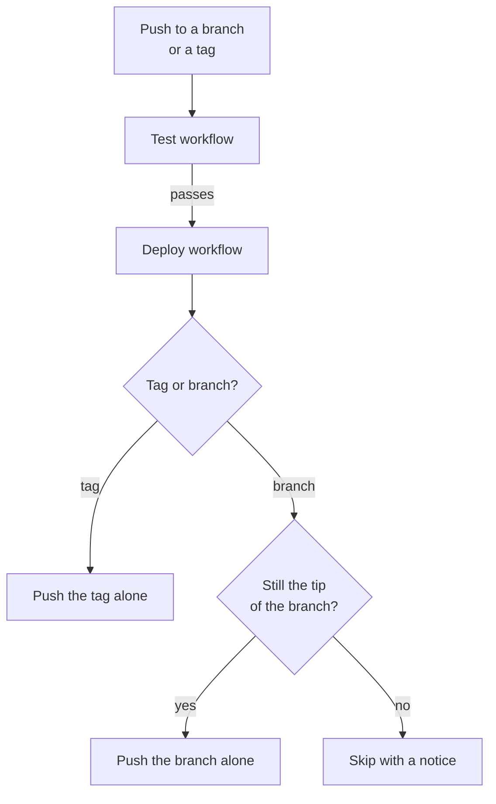

# Deployment

After the tests pass, CI mirrors the code to a destination repository: your extension's repository on Drupal.org, or any other git remote. You develop on GitHub, and CI does the pushing to Drupal.org for you. This page explains what deploys, the order that deployments run in and what turns deployment on.

[drevops/eddy_destination](https://github.com/drevops/eddy_destination) shows a destination repository at work: Eddy deploys itself there the same way.

## What deploys

CI deploys pushes to the branches in the `push` filter of `.github/workflows/test.yml`, which the installer sets to `1.x` or to the branches in `INSTALL_BRANCHES` (see [What the installer changes](../installation.mdx#what-the-installer-changes)), and each tag whose own `Test` run passes. Pull requests never deploy. To deploy another branch, such as `2.x`, add it to that filter. Updating the scaffold with the [`update-consumer-eddy`](../updating/README.mdx) skill keeps the branches you list there.

The 2 kinds of push deploy differently:

- **A branch push** force-pushes the commit that CI tested to the branch of the same name in the destination repository. The first deployment of a branch creates it there. It pushes no tags, so a tag whose own `Test` run fails stays off the destination (see [Tags that don't deploy](#tags-that-dont-deploy)).
- **A tag** is deployed as that tag alone and leaves the destination branches untouched, so a tag behind a branch's tip can't rewind the branch.

To send the branches to a destination branch of another name, set the `DEPLOY_BRANCH` repository variable to it, such as `1.x` when you develop on `main` and have added `main` to the `push` filter. It applies to every branch that deploys, while tags stay tags. So use it when only 1 branch deploys: with several, they all force-push to that 1 destination branch, and the latest deployment replaces the others.

### Tags that don't deploy

A tag reaches the destination only through its own deployment, after its own `Test` run passes. That keeps a tag that fails its tests off Drupal.org, where a tag can't be moved or deleted after a release uses it. A tag stays off the destination in these cases:

- **Its `Test` run fails.** Fix the code and release the fix under a new tag, such as `1.2.1` after a failed `1.2.0`. When the failure has nothing to do with the code, such as a flaky test, re-run the `Test` run instead.
- **Deployment was off when its `Test` run passed.** The `DEPLOY_REMOTE` secret wasn't set yet, or `DEPLOY_PROCEED` wasn't `1`.
- **Its deployment failed.** For example, the `DEPLOY_SSH_KEY` secret was missing, or the destination was unreachable.
- **It came in a push of more than 3 tags.** GitHub [creates no push event](https://docs.github.com/en/actions/reference/workflows-and-actions/events-that-trigger-workflows#push) for the tags of such a push, so no `Test` run starts. Push tags 3 at a time at most.
- **A workflow created it with `GITHUB_TOKEN`.** GitHub starts no workflow run for an event that `GITHUB_TOKEN` causes, so no `Test` run starts. To give each tag a `Test` run, create the tags with a [GitHub App installation token or a personal access token](https://docs.github.com/en/actions/how-tos/write-workflows/choose-when-workflows-run/trigger-a-workflow) instead.

To deploy a tag that has a `Test` run, re-run that run from the **Actions** tab of your repository. When the re-run passes, a new `Deploy` run pushes the tag. The `Deploy` run reads the secrets as they are when it starts, so a tag that passed while deployment was off deploys after you turn deployment on. GitHub lets you [re-run a workflow run](https://docs.github.com/en/actions/how-tos/manage-workflow-runs/re-run-workflows-and-jobs) up to 30 days after it first ran.

A tag without a `Test` run, or whose `Test` run is more than 30 days old, has no run to re-run. If its commit passed `Test`, for example when it deployed as the tip of its branch, push the tag to the destination yourself. Otherwise, release the commit under a new tag, which gets a `Test` run of its own.

To push a tag yourself, run `git push <remote> refs/tags/<tag>` from a clone that holds it, with your own access to the destination. `<remote>` is the address you set as the `DEPLOY_REMOTE` secret, such as `git@git.drupal.org:project/myextension.git`. Git refuses a short name that matches both a branch and a tag, so the command names the tag in full. The push skips `Test`, so use it only for a commit that already passed.

To confirm that a tag reached the destination, run `git ls-remote --tags <remote>`, or look for "Tag pushed to" in the `Deploy to Remote` step of its `Deploy` run.

## Deployment order

Each deployment of a branch waits for the previous one, then checks the branch on GitHub right before it pushes. When the tested commit is no longer the tip of the branch, it skips the deployment with a notice, and the run passes. That happens after a newer push, and when you re-run the `Test` or `Deploy` run of an older commit, so an older commit of the branch never replaces a newer one. Deployments of different branches don't wait for each other, even when `DEPLOY_BRANCH` sends them to the same destination branch.

## Turn on deployment

CI pushes with an SSH key, and reads its settings from repository secrets and the optional `DEPLOY_BRANCH` variable. The `Deploy` workflow checks the secrets in this order:

1. Without `DEPLOY_REMOTE`, it reports a notice and skips its other steps, so the run passes.
2. Without `DEPLOY_SSH_KEY`, `DEPLOY_USER_NAME` or `DEPLOY_USER_EMAIL`, it fails.
3. Without the `DEPLOY_PROCEED` secret set to `1`, it stops before the push with "Skip deployment because DEPLOY_PROCEED is not set to 1." and passes, which lets you test it first.

With all 5 secrets set, the workflow pushes.

[Set up deployment](setup.mdx) walks through the key and the secrets.
