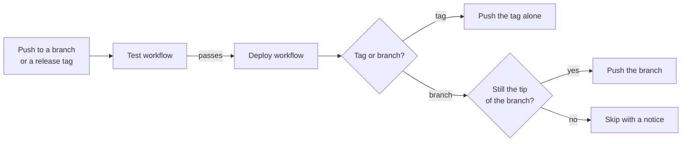

# Deployment

Once the tests pass, CI mirrors the code to your extension's Drupal.org repository, or any other git remote. You develop on GitHub, and Drupal.org gets every tested commit and release tag without a manual push.

[drevops/eddy_destination](https://github.com/drevops/eddy_destination) shows a destination repository at work: Eddy deploys itself there the same way.

## What deploys

CI deploys pushes to the `1.x` branch and release tags, and pull requests never deploy. To deploy another branch, such as `2.x`, add it to the `push` branches in `.github/workflows/test.yml`. Updating the scaffold with the [`update-consumer-eddy`](../updating/README.mdx) skill keeps the branches you list there.

- **A branch push** deploys the commit that CI tested to the same branch of the destination repository, or to the branch that `DEPLOY_BRANCH` names. The first deployment of a branch creates it there.
- **A release tag** is deployed as that tag alone and leaves the destination branches untouched, so a tag behind a branch's tip can't rewind the branch.

## Deployments never overtake each other

Deployments of a branch never overlap: each one waits for the previous one, then checks the branch on GitHub right before it pushes. When the branch has moved on, or an older run is re-run, it skips the deployment with a notice, so an older commit never replaces a newer one.

## Turning it on

CI pushes with an SSH key and reads its settings from repository secrets. Until the `DEPLOY_REMOTE` secret is set, the `Deploy` workflow reports a notice and skips its steps instead of failing, and until `DEPLOY_PROCEED` is `1`, it runs without pushing, which lets you test the job first.

[Setting up deployment](setup.mdx) walks through the key and the secrets.
