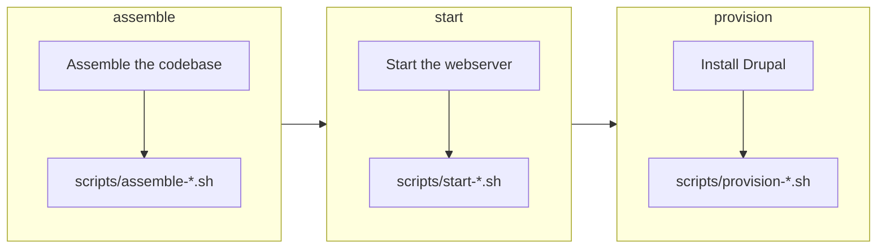

import CommandTabs from '@site/src/components/CommandTabs';

# Build the site

`build` assembles a Drupal codebase in the `build` directory and starts the PHP webserver. It then installs the Drupal website with your extension enabled, the same way CI builds it. `assemble` links your extension's files into the site, so an edit in your project shows up in the site straight away. This page covers what each step does and how to see the full output when a step fails.

To build the site, run the following command from the root of your project:

<CommandTabs
  make={`make build`}
  ahoy={`ahoy build`}
  none={`scripts/eddy-tooling          # Install the tooling
vendor/bin/eddy-assemble      # Assemble the codebase
vendor/bin/eddy-start         # Start the PHP server
vendor/bin/eddy-provision     # Provision the Drupal website`}
/>

Without a wrapper, run `scripts/eddy-tooling` first: it installs the `vendor/bin/eddy-*` commands that run after it. `make` and Ahoy run it for you (see [Tooling package](tooling.mdx)).

Confirm that the build worked: it ends with `PROVISION COMPLETE`, the site URL and a one-time login link.

## What `build` runs

`build` runs `assemble`, `start` and `provision` in turn. Each command ends by running your [lifecycle scripts](lifecycle-scripts.mdx) for its phase:

To run only part of the job, run the commands on their own:

<CommandTabs
  make={`make assemble     # Assemble the codebase
make start        # Start the PHP server
make provision    # Provision the Drupal website`}
  ahoy={`ahoy assemble     # Assemble the codebase
ahoy start        # Start the PHP server
ahoy provision    # Provision the Drupal website`}
  none={`vendor/bin/eddy-assemble      # Assemble the codebase
vendor/bin/eddy-start         # Start the PHP server
vendor/bin/eddy-provision     # Provision the Drupal website`}
/>

To reinstall the website on the codebase you already have, run `provision` on its own. After you change `composer.json`, `composer.dev.json` or a patch, run `build` again.

### What `assemble` does

`assemble` builds a fresh codebase every time, in this order:

1. Checks your project: its `composer.json` and `.info.yml`, the `composer` command and `composer validate --strict`.
2. Passes `GITHUB_TOKEN` to Composer as `COMPOSER_AUTH`, unless `COMPOSER_AUTH` is set (see [Set `GITHUB_TOKEN`](dependencies.mdx#set-github_token)).
3. Resolves the Drupal release to build from `DRUPAL_VERSION` (see [Drupal versions](drupal-versions.mdx)).
4. Checks that the PHP running the build meets that release's PHP requirement, and that any `config.platform.php` you set meets it too. When either falls short, `assemble` stops before it touches `build`.
5. Stops the webserver when it still serves an earlier build of this project. Like the `stop` command, it first runs your `scripts/stop-*.sh` [lifecycle scripts](lifecycle-scripts.mdx). This step comes after the checks, so a failed check leaves your site running.
6. Removes the old `build` directory and creates a Drupal project from [drupal/recommended-project](https://www.drupal.org/docs/develop/using-composer/starting-a-site-using-drupal-composer-project-templates), with core pinned to the resolved release.
7. Sets the stability that resolves the other dependencies (see [How versions are resolved](drupal-versions.mdx#how-versions-are-resolved)), and the versions of the test tools that fit the Drupal major. A Drupal 12 build also gets PHPUnit 12 and installs `drupal/core` from source.
8. Merges the development dependencies and settings of `composer.dev.json` into the project, then those of your extension's `composer.json`. Then it pins the PHP platform.
9. Copies your `patches` directory into `build` and installs the dependencies, which applies your [patches](dependencies.mdx#patch-dependencies). Then it adds the extensions you [`suggest`](dependencies.mdx#optional-dependencies).
10. Lists every dependency it installed from a development branch, so you can see when a build relies on unreleased code.
11. Turns off deprecation notices when `SYMFONY_DEPRECATIONS_HELPER` is `disabled` (see [Deprecated code](../testing/README.mdx#deprecated-code)). It writes the setting into the site's `index.php` and `default.settings.php`, and into the core copy of `default.settings.php` that Functional test sites start from.
12. Copies the configuration files of the tools into `build`, because some tools misread a symlinked configuration file. Edit these files in your project, and run `assemble` again to apply a change. It copies each of the following files that your project has:
    - `phpcs.xml`, `phpstan.neon`, `rector.php` and `.twig-cs-fixer.php`, for the PHP linters
    - `.eslintrc.json`, `.eslintignore`, `.prettierrc.json`, `.prettierignore` and `.stylelintrc.js`, for the JavaScript and CSS linters
    - `phpunit.xml`, or `phpunit.d10.xml` in its place in a Drupal 10 build
    - `jest.config.js`, `package.json` and `package-lock.json`, for Jest and npm
13. Creates your extension's directory in the site: `build/web/modules/custom/<your_extension>` for a module or `build/web/themes/custom/<your_extension>` for a theme. The directory holds a symlink to every top-level file and directory of your project, apart from `build`, `vendor` and the names that start with a dot.
14. Runs `npm ci` and `npm run build` in `build` when your project has a `package-lock.json` and no `.skip_npm_build` file (see [Frontend dependencies](dependencies.mdx#frontend-dependencies)).
15. Runs your `scripts/assemble-*.sh` [lifecycle scripts](lifecycle-scripts.mdx).

## Other commands along the way

These commands help you look at the build and clear it away:

- `info` (alias `describe`) prints a read-only summary of the environment. It shows the versions of Drupal, PHP and the tools, plus the webserver host and port with the source of each. It also shows the site URL, the XDebug state, the build directory, the database path and the install profile. With FunctionalJavascript tests, it adds the WebDriver port.
- `reset` (aliases `delete` and `destroy`) stops the project's webserver and browser. Then it removes the `build`, `.logs` and `vendor` directories from the project root. Removing `vendor` is also how a local checkout picks up a newer patch release of the [tooling](tooling.mdx). `reset` keeps the [database](provisioning.mdx#the-database) file, and the next `provision` reinstalls the site in it.
- `make help` lists the `make` commands, since a bare `make` runs `build`. A bare `ahoy` lists the Ahoy ones.

To summarize the environment or start over, run the following commands:

<CommandTabs
  make={`make info     # Summarize the environment
make reset    # Remove build, .logs and vendor`}
  ahoy={`ahoy info     # Summarize the environment
ahoy reset    # Remove build, .logs and vendor`}
  none={`vendor/bin/eddy-info    # Summarize the environment`}
/>

Without a wrapper, run `vendor/bin/eddy-stop` and `vendor/bin/eddy-browser-stop`, then remove `build`, `.logs` and `vendor`, to do what `reset` does.

`vendor/bin/eddy-info` also prints a single field when you name it, such as `vendor/bin/eddy-info site-url`. The wrappers find the site URL that way. For the full list, see [`eddy-info` fields](tooling.mdx#eddy-info-fields).

## See the full output

The build hides the output of Composer, `npm ci` and Drush until a command fails. To stream that output as it happens, set `DEBUG=1`:

<CommandTabs
  make={`DEBUG=1 make build`}
  ahoy={`DEBUG=1 ahoy build`}
  none={`export DEBUG=1
vendor/bin/eddy-assemble
vendor/bin/eddy-start
vendor/bin/eddy-provision`}
/>

[Command output](debugging.mdx#command-output) covers which output `DEBUG` streams, and [Logs](debugging.mdx#logs) covers the processes that keep running after a command returns.

## Your extension's contributors

The installer generates a `CONTRIBUTING.md` that documents these commands for the people who work on your extension. It names only the command wrappers and tools you kept.
