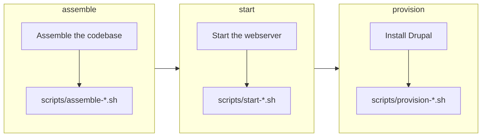

import CommandTabs from '@site/src/components/CommandTabs';

# Building the site

`build` assembles the codebase in the `build` directory, starts the PHP webserver and installs the Drupal website with your extension enabled. Your extension's files are symlinked into the site, so an edit in your project shows up in the site straight away, and CI builds it the same way.

<CommandTabs
  make={`make build`}
  ahoy={`ahoy build`}
  none={`scripts/eddy-tooling          # Install the tooling
vendor/bin/eddy-assemble      # Assemble the codebase
vendor/bin/eddy-start         # Start the PHP server
vendor/bin/eddy-provision     # Provision the Drupal website`}
/>

## What `build` runs

`build` stops a webserver that's still running from an earlier build, then runs 3 commands in turn, and each one runs your [lifecycle scripts](lifecycle-scripts.mdx) for its phase:

<CommandTabs
  make={`make assemble     # Assemble the codebase
make start        # Start the PHP server
make provision    # Provision the Drupal website`}
  ahoy={`ahoy assemble     # Assemble the codebase
ahoy start        # Start the PHP server
ahoy provision    # Provision the Drupal website`}
  none={`vendor/bin/eddy-assemble      # Assemble the codebase
vendor/bin/eddy-start         # Start the PHP server
vendor/bin/eddy-provision     # Provision the Drupal website`}
/>

Run them on their own when you only need part of the job. `provision` reinstalls the website without reassembling the codebase, which is much faster when only the site's state needs a reset.

### Assembling the codebase

`assemble` builds a fresh codebase every time, in this order:

1. It checks your extension and the tools it uses, and resolves the Drupal release to build from `DRUPAL_VERSION` (see [Drupal versions](drupal-versions.mdx)).
2. It checks that the PHP running the build meets that release's PHP requirement, and stops before it touches `build` when it doesn't.
3. It removes the old `build` directory and creates a Drupal project from [drupal/recommended-project](https://www.drupal.org/docs/develop/using-composer/starting-a-site-using-drupal-composer-project-templates), with core pinned to the resolved release.
4. It merges the development dependencies and settings of `composer.dev.json` and your extension's `composer.json` into the project, and pins the PHP platform.
5. It installs the dependencies, applies your [patches](dependencies.mdx#patching-dependencies), and adds the extensions you [`suggest`](dependencies.mdx#optional-dependencies).
6. It copies the configuration files of the linters and PHPUnit into `build`, because not every tool resolves a symlinked configuration file correctly.
7. It symlinks every top-level file and directory of your project into the site, apart from `build` and `vendor`: `web/modules/custom/<your_extension>` for a module, or `web/themes/custom/<your_extension>` for a theme.
8. It runs `npm ci` and `npm run build` in `build` when your project has a `package-lock.json` and no `.skip_npm_build` file (see [Frontend dependencies](dependencies.mdx#frontend-dependencies)).
9. It runs your `scripts/assemble-*.sh` [lifecycle scripts](lifecycle-scripts.mdx).

The build lists every dependency it installed from a development branch rather than a release, so you can see when a build leans on unreleased code.

## Other commands along the way

- `info` (alias `describe`) prints a read-only summary of the environment: the PHP, Drupal, Composer, Drush, Node.js and npm versions, the webserver host and port with where each came from, the site URL, the XDebug state, the WebDriver port, the build directory, the database path and the install profile.
- `reset` (aliases `delete` and `destroy`) stops the project's webserver and browser, and removes the `build`, `.logs` and `vendor` directories. Removing `vendor` is also how a local checkout picks up a newer patch release of the [tooling](tooling.mdx).
- `make help` lists the `make` commands, since a bare `make` runs `build` instead. A bare `ahoy` lists the Ahoy ones.

<CommandTabs
  make={`make info     # Summarize the environment
make reset    # Remove build, .logs and vendor`}
  ahoy={`ahoy info     # Summarize the environment
ahoy reset    # Remove build, .logs and vendor`}
  none={`vendor/bin/eddy-info    # Summarize the environment`}
/>

`vendor/bin/eddy-info` also prints a single field when you name it, such as `vendor/bin/eddy-info site-url`, which is how the wrappers find the site URL.

## Seeing the full output

The build hides the output of Composer, npm and Drush unless a command fails, so a normal run shows only its own progress. When something goes wrong, the failing command's output appears. To watch everything as it happens, set `DEBUG=1`:

<CommandTabs
  make={`DEBUG=1 make build`}
  ahoy={`DEBUG=1 ahoy build`}
  none={`DEBUG=1 vendor/bin/eddy-assemble`}
/>

[Debugging](debugging.mdx) covers the logs of the processes that keep running after a command returns.

## Your extension's contributors

The `CONTRIBUTING.md` that the installer generates documents these commands for the people who work on your extension, with only the command wrappers and tools you kept.
