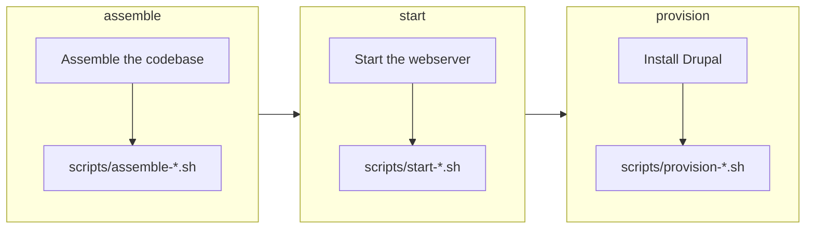

import CommandTabs from '@site/src/components/CommandTabs';

# Build the site

`build` assembles the codebase in the `build` directory, starts the PHP webserver and installs the Drupal website with your extension enabled. Your extension's files are linked into the site, so an edit in your project shows up in the site straight away, and CI builds it the same way. This page shows what each step does, and how to see the full output when a step fails.

To build the site, run the following command:

<CommandTabs
  make={`make build`}
  ahoy={`ahoy build`}
  none={`scripts/eddy-tooling          # Install the tooling
vendor/bin/eddy-assemble      # Assemble the codebase
vendor/bin/eddy-start         # Start the PHP server
vendor/bin/eddy-provision     # Provision the Drupal website`}
/>

## What `build` runs

`build` runs 3 commands in turn, and each one runs your [lifecycle scripts](lifecycle-scripts.mdx) for its phase:

To run only part of the job, run the commands on their own:

<CommandTabs
  make={`make assemble     # Assemble the codebase
make start        # Start the PHP server
make provision    # Provision the Drupal website`}
  ahoy={`ahoy assemble     # Assemble the codebase
ahoy start        # Start the PHP server
ahoy provision    # Provision the Drupal website`}
  none={`vendor/bin/eddy-assemble      # Assemble the codebase
vendor/bin/eddy-start         # Start the PHP server
vendor/bin/eddy-provision     # Provision the Drupal website`}
/>

`provision` reinstalls the website without reassembling the codebase, which is much faster when only the site's state needs a reset.

### What `assemble` does

`assemble` builds a fresh codebase every time, in this order:

1. Checks your project: its `composer.json` and `.info.yml`, the `composer` command and `composer validate --strict`.
2. Passes `GITHUB_TOKEN` to Composer as `COMPOSER_AUTH`, unless `COMPOSER_AUTH` is set (see [Set `GITHUB_TOKEN`](dependencies.mdx#set-github_token)).
3. Resolves the Drupal release to build from `DRUPAL_VERSION` (see [Drupal versions](drupal-versions.mdx)).
4. Checks the PHP that runs the build, and any `config.platform.php` you set, against that release's PHP requirement, and stops before it touches `build` when either falls short.
5. Stops the webserver when it's still serving an earlier build of this project, running your `scripts/stop-*.sh` [lifecycle scripts](lifecycle-scripts.mdx) first, the way `stop` does. It comes after the checks, so a failed check leaves your site running.
6. Removes the old `build` directory and creates a Drupal project from [drupal/recommended-project](https://www.drupal.org/docs/develop/using-composer/starting-a-site-using-drupal-composer-project-templates), with core pinned to the resolved release.
7. Sets the stability that resolves the other dependencies (see [How versions are resolved](drupal-versions.mdx#how-versions-are-resolved)), and the versions of the test tools that fit the Drupal major. A Drupal 12 build also gets PHPUnit 12, and installs `drupal/core` from source.
8. Merges the development dependencies and settings of `composer.dev.json`, then those of your extension's `composer.json`, into the project, and pins the PHP platform.
9. Copies your `patches` directory into `build`, installs the dependencies, which applies your [patches](dependencies.mdx#patch-dependencies), and adds the extensions you [`suggest`](dependencies.mdx#optional-dependencies).
10. Lists every dependency it installed from a development branch rather than a release, so you can see when a build relies on unreleased code.
11. Turns off deprecation notices in the site's `index.php` and `default.settings.php` when `SYMFONY_DEPRECATIONS_HELPER` is `disabled` (see [Deprecated code](../testing/README.mdx#deprecated-code)).
12. Copies the configuration files of the linters, PHPUnit, Jest and npm into `build`, because not every tool resolves a symlinked configuration file correctly. In a Drupal 10 build, `phpunit.d10.xml` replaces `phpunit.xml` there. Edit these files in your project, not in `build`, and run `assemble` again to apply a change.
13. Creates your extension's directory in the site, `web/modules/custom/<your_extension>` for a module or `web/themes/custom/<your_extension>` for a theme. It holds a symlink to every top-level file and directory of your project, apart from `build`, `vendor` and the names that start with a dot.
14. Runs `npm ci` and `npm run build` in `build` when your project has a `package-lock.json` and no `.skip_npm_build` file (see [Frontend dependencies](dependencies.mdx#frontend-dependencies)).
15. Runs your `scripts/assemble-*.sh` [lifecycle scripts](lifecycle-scripts.mdx).

## Other commands along the way

These commands help you look at the build and clear it away:

- `info` (alias `describe`) prints a read-only summary of the environment: the versions of Drupal, PHP and the tools, the webserver host and port with where each came from, the site URL, the XDebug state, the build directory, the database path and the install profile. With FunctionalJavascript tests, it adds the WebDriver port.
- `reset` (aliases `delete` and `destroy`) stops the project's webserver and browser, and removes the `build`, `.logs` and `vendor` directories. Removing `vendor` is also how a local checkout picks up a newer patch release of the [tooling](tooling.mdx).
- `make help` lists the `make` commands, since a bare `make` runs `build` instead. A bare `ahoy` lists the Ahoy ones.

To summarize the environment or start over, run the following commands:

<CommandTabs
  make={`make info     # Summarize the environment
make reset    # Remove build, .logs and vendor`}
  ahoy={`ahoy info     # Summarize the environment
ahoy reset    # Remove build, .logs and vendor`}
  none={`vendor/bin/eddy-info    # Summarize the environment`}
/>

Without a wrapper, `reset` is `vendor/bin/eddy-stop` and `vendor/bin/eddy-browser-stop`, then the removal of `build`, `.logs` and `vendor`.

`vendor/bin/eddy-info` also prints a single field when you name it, such as `vendor/bin/eddy-info site-url`, which is how the wrappers find the site URL. For the full list, see [`eddy-info` fields](tooling.mdx#eddy-info-fields).

## See the full output

The build hides the output of Composer, `npm ci` and Drush, unless a command fails, so a normal run shows its own progress. The output of `npm run build` and of your lifecycle scripts always shows. When something goes wrong, the failing command's output appears.

To watch everything as it happens, set `DEBUG=1`:

<CommandTabs
  make={`DEBUG=1 make build`}
  ahoy={`DEBUG=1 ahoy build`}
  none={`export DEBUG=1
vendor/bin/eddy-assemble
vendor/bin/eddy-start
vendor/bin/eddy-provision`}
/>

[Debug your extension](debugging.mdx) covers the logs of the processes that keep running after a command returns.

## Your extension's contributors

The `CONTRIBUTING.md` that the installer generates documents these commands for the people who work on your extension, with only the command wrappers and tools you kept.
