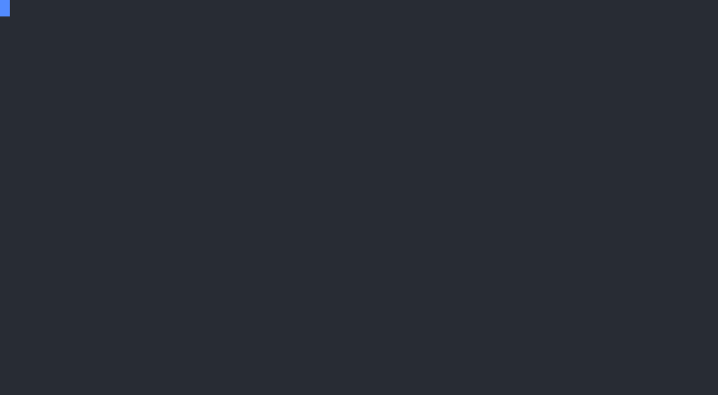

import CommandTabs from '@site/src/components/CommandTabs';

# Testing

`test` runs every PHPUnit test suite and the Jest tests against the site you [built](../development/building.mdx):

<CommandTabs
  make={`make test`}
  ahoy={`ahoy test`}
  none={`vendor/bin/eddy-browser-start
export WEBDRIVER_PORT="$(vendor/bin/eddy-info webdriver-port)"
export WEBSERVER_PORT="$(vendor/bin/eddy-info webserver-port)"
export SIMPLETEST_BASE_URL="http://localhost:\${WEBSERVER_PORT}"
cd build
php -d pcov.directory=.. vendor/bin/phpunit
npm test`}
/>

The PHPUnit tests live in `tests/src`, in a directory per suite, and the installer gives a module a working example of each. A theme gets the FunctionalJavascript one, which renders pages with the theme as the default theme, since the others test the example module's service and settings form. To run the tests of an extension you bundle with yours, see [Bundled extensions](../development/bundled-extensions.mdx#what-the-tooling-covers). `phpunit.xml` configures PHPUnit, and `phpunit.d10.xml` replaces it in a Drupal 10 build. Both bootstrap Drupal with core's `web/core/tests/bootstrap.php`, and both fail a run on a PHPUnit warning. The installer removes `phpunit.d10.xml` when you don't select Drupal 10, since no other build reads it.

## Running 1 suite

Each suite also has a command of its own:

<CommandTabs
  make={`make test-unit                    # Run Unit tests
make test-kernel                  # Run Kernel tests
make test-functional              # Run Functional tests
make test-functional-javascript   # Run FunctionalJavascript tests
make test-javascript              # Run JavaScript unit tests (Jest)`}
  ahoy={`ahoy test-unit                    # Run Unit tests
ahoy test-kernel                  # Run Kernel tests
ahoy test-functional              # Run Functional tests
ahoy test-functional-javascript   # Run FunctionalJavascript tests
ahoy test-javascript              # Run JavaScript unit tests (Jest)`}
  none={`export WEBSERVER_PORT="$(vendor/bin/eddy-info webserver-port)"
export SIMPLETEST_BASE_URL="http://localhost:\${WEBSERVER_PORT}"
cd build
php -d pcov.directory=.. vendor/bin/phpunit --testsuite unit
php -d pcov.directory=.. vendor/bin/phpunit --testsuite kernel
php -d pcov.directory=.. vendor/bin/phpunit --testsuite functional`}
/>

| Suite                 | Directory                       | Needs                                                                                     |
|-----------------------|---------------------------------|-------------------------------------------------------------------------------------------|
| Unit                  | `tests/src/Unit`                | Nothing beyond the codebase.                                                              |
| Kernel                | `tests/src/Kernel`              | A database, which the tests install themselves.                                           |
| Functional            | `tests/src/Functional`          | The running webserver.                                                                     |
| FunctionalJavascript  | `tests/src/FunctionalJavascript`| The running webserver and a browser. See [FunctionalJavascript tests](functional-javascript.mdx). |

## Running specific tests

Pass a test file, or PHPUnit options such as `--filter` or `--group`, to a test command. PHPUnit runs inside `build`, so a test path starts at your extension's symlink in the assembled site (`web/themes/custom/` for a theme):

<CommandTabs
  make={`make test-unit web/modules/custom/your_extension/tests/src/Unit/MyUnitTest.php
make test-unit -- --group=wip
make test-unit -- --filter=MyUnitTest::testSomething`}
  ahoy={`ahoy test-unit web/modules/custom/your_extension/tests/src/Unit/MyUnitTest.php
ahoy test-unit -- --group=wip
ahoy test-unit -- --filter=MyUnitTest::testSomething`}
  none={`cd build
php -d pcov.directory=.. vendor/bin/phpunit \\
  web/modules/custom/your_extension/tests/src/Unit/MyUnitTest.php
php -d pcov.directory=.. vendor/bin/phpunit --group=wip
php -d pcov.directory=.. vendor/bin/phpunit --filter=MyUnitTest::testSomething`}
/>

Put `--` before the arguments when they include an option, since `make` reads an option on its command line as its own. An argument can't hold a space or name a `make` target, such as `test`, unless it's an option value joined with `=`, as in `--filter='my test'` or `--filter=test`. `make` keeps 1 value per option joined with `=`, so repeat an option with a space instead, as in `--group wip --group slow`.

## JavaScript tests

Jest runs the `*.test.js` files in the `js` directory of your extension, in a simulated browser environment (jsdom), with the configuration in `jest.config.js`:

<CommandTabs
  make={`make test-javascript`}
  ahoy={`ahoy test-javascript`}
  none={`cd build
npm test`}
/>

`test-javascript` is also available as `test-js`. Jest runs from the frontend dependencies that the build installs, so it doesn't run when a `.skip_npm_build` file turns those off (see [Frontend dependencies](../development/dependencies.mdx#frontend-dependencies)).

## Code coverage

PHPUnit collects code coverage with [pcov](https://github.com/krakjoe/pcov) and Jest with V8, and both write their reports to `.logs/coverage`: an HTML report to browse and a Cobertura file for tools, in `phpunit` and `jest` subdirectories. CI uploads the reports as a workflow artifact, and to [Codecov](https://codecov.io) when the `CODECOV_TOKEN` repository secret is set.

## Deprecated code

The tests fail when they find deprecated code. To ignore some deprecations, add a `.deprecation-ignore.txt` file to the root of the codebase and set the `SYMFONY_DEPRECATIONS_HELPER` environment variable to `ignoreFile=../.deprecation-ignore.txt` in `phpunit.xml`, and in `phpunit.d10.xml` for Drupal 10. PHPUnit runs from the `build` directory, so the path is relative to it. See [the change record](https://www.drupal.org/node/3285162) for details.

CI test jobs on PHP 8.4 or newer set `SYMFONY_DEPRECATIONS_HELPER` to `disabled`, because not every tested Drupal version fully supports the newer PHP versions yet. Adjust this to your project's deprecation policy.

When `SYMFONY_DEPRECATIONS_HELPER` is `disabled` in the environment that runs `assemble`, as it is in those CI jobs, the build also keeps deprecation notices out of the pages that Functional tests read. A notice then can't fail a test by showing up in a page.

## Test output

Functional and FunctionalJavascript tests save the HTML of every page they visit, and FunctionalJavascript tests their screenshots, to `.logs/browser_output`. The last lines of a run list the pages it saved. CI uploads the directory as a workflow artifact, so a failure in CI comes with the pages that led to it.
