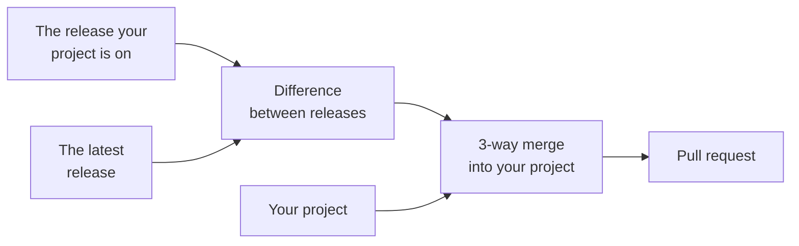

# Update your extension

When Eddy changes, you can merge the changes into your extension: new CI jobs, tooling releases, fixes to the build and the docs it generates. Your own code and your own changes to the template stay as they are. This page shows how to update with Claude Code or by hand, and what stays current between updates.

:::info Coming from 4.x?

An extension created from a 4.x release needs a one-off upgrade to 5.x first: its `AGENTS.md` fetches the update skill from a URL that returns 404, and the upgrade replaces `.devtools/` with the tooling package and CircleCI with GitHub Actions. [Upgrade a 4.x project to 5.x](upgrading-from-4x.mdx) walks you through it.

:::

## Update with Claude Code

If you use Claude Code, ask Claude to "update scaffold" in your project. The `AGENTS.md` that Eddy generated tells Claude to fetch the [`update-consumer-eddy`](https://github.com/drevops/eddy/blob/main/.eddy/skills/update-consumer-eddy/SKILL.md) skill with these commands, which Claude runs itself, and then to follow it:

```bash
mkdir -p .claude/skills/update-consumer-eddy
```

```bash
curl -fsSL -o .claude/skills/update-consumer-eddy/SKILL.md \
  https://raw.githubusercontent.com/drevops/eddy/main/.eddy/skills/update-consumer-eddy/SKILL.md
```

The skill renders 2 releases, the release your project is on and the release it updates to, with answers it reads from your project as it is now. Then it merges the difference between them into your project:



Only lines that both sides changed need a decision, and the skill makes it: it keeps your change and applies the release's next to it. Then it builds, lints and tests the result, and opens a pull request that lists the conflicts it resolved by judgment. Without a [command wrapper](../development/README.mdx#commands-at-a-glance), it leaves the lint and the tests to the pull request's CI.

The merge leaves out your extension's own code, which step 4 of [Update by hand](#update-by-hand) lists, and keeps your own files and your changes to the template. The skill changes these files on top of the merge:

- It takes `scripts/eddy-tooling` from the release, even when you changed it, and lists your change in the pull request as one that belongs in a [patch for the package](../development/tooling.mdx#patch-the-package).
- It removes a template file that the release removed, even when you changed it, and lists it in the pull request.
- It keeps your `package-lock.json`, and regenerates it when the merged `package.json` changed.
- It finds references in the docs and configurations to example files that your project doesn't have, and points them at your own files or removes them.
- For a project from 4.x, it removes `.devtools/`, `.circleci/` and the Cloudflare tunnel hooks.

The skill decides these from what it finds:

- **Which release.** Without a tag, the skill updates to the release with the highest version among the 10 most recently published releases that aren't drafts or marked as pre-releases on GitHub. To update to a particular release, name its tag: `/update-consumer-eddy <tag>`. When your project is already on that release or a newer one, the skill stops, unless you add or drop a Drupal major.
- **Which release you're on.** The skill reads it from `extra.eddy.version` in `composer.dev.json`, or from your last scaffold update commit. The installer records that value when it comes from a GitHub archive, and every update records it again. An extension created from a branch download records the commit it came from, such as `5.0.0-3-g1a2b3c4`, and the skill renders that commit in place of a release. Without a recorded release, or with one older than 4.14.0, every difference between your files and the new release's comes up for a decision.
- **Adding or dropping a Drupal major.** Ask for it in the same request, such as `/update-consumer-eddy add Drupal 12`. The skill changes the major's CI jobs and badges, and for a new major, makes the code changes it needs, each in a commit of its own. It does this even when there's no newer release to update to.
- **Permissions.** On its first run, the skill might add a few command permissions to `.claude/settings.local.json` and ask you to restart Claude Code. Run it again after the restart.

## Update by hand

To update without Claude Code:

1. Read the notes of every release after the one your project is on, which `extra.eddy.version` in `composer.dev.json` names, on the [releases page](https://github.com/drevops/eddy/releases). Look for breaking changes.
2. [Run the installer](../installation.mdx#run-the-installer) in a new, empty directory, and repeat the answers your project uses. It installs the release in this site's footer: to update to another release, or to the current code, [install from a download](../installation.mdx#install-from-a-download) instead. That directory isn't a clone of your repository, so pass the branches your workflows run on and your GitHub repository, such as `INSTALL_BRANCHES=1.x,2.x INSTALL_GITHUB_REPOSITORY=owner/myextension php install.php`. Your project shows its answers in these places:
   - The name and the type in the `name` and `type` of its `.info.yml`, and the machine name in that file's name
   - The command wrappers in which of `.ahoy.yml` and `Makefile` it has
   - The Drupal majors in the `drupal-version` values of `.github/workflows/test.yml`
   - The tools in their configuration files, such as `phpcs.xml` for PHPCS and `renovate.json` for Renovate
3. Create a new branch in your extension's repository.
4. Copy the new files into your extension's directory, apart from your extension's own code: `src`, `tests`, `config`, `css`, `js`, `composer.json`, `logo.png`, the files named after your machine name and `scripts/*-example.sh`. The new files hold the example extension under your machine name, so copying those would overwrite your code.
5. Remove the template files that the new release dropped. To find them, [install from a download](../installation.mdx#install-from-a-download) of the release your project is on, into another new directory and with the same answers. Then remove from your project each file that this directory has and the one from step 2 doesn't, apart from the paths that step 4 leaves out.
6. Resolve the differences between the new files and yours. Keep your own branches in the workflow branch filters and your repository in the README badges, unless you passed them in step 2. Keep the `extra.eddy.version` of the new `composer.dev.json`, so the next update knows the release you're on. Take `scripts/eddy-tooling` as the release ships it, and drop any change you made to it: to change what a tooling command does, [patch the package](../development/tooling.mdx#patch-the-package) instead.
7. When your project has a `package-lock.json`, restore your own copy with `git checkout HEAD -- package-lock.json`. If `package.json` changed, run `npm install --package-lock-only` to bring the lock file in line with it.
8. [Build the site](../development/building.mdx), [check coding standards](../development/coding-standards.mdx) and [run the tests](../testing/README.mdx).
9. Commit and push to your GitHub repository, and check that every CI job passes.
10. Merge the new branch into your main branch, and check that the deployment job works.

To add or drop a Drupal major by hand, select the majors you want in step 2. Your `.info.yml` files stay out of the copy, so add a new major to their `core_version_requirement` yourself, in every `*.info.yml` your project has. For Drupal 12, also make the other code changes that [Drupal 12](upgrading-from-4x.mdx#drupal-12) lists.

## What else stays current

Between scaffold updates, these parts stay current on their own:

- The [tooling package](../development/tooling.mdx) takes its patch releases within the `~` constraint in `composer.dev.json`. CI installs the newest on every run, and a local checkout takes it after [`reset`](../development/README.mdx#commands-at-a-glance). A scaffold update raises the constraint for a new minor version.
- When you keep Renovate, it keeps the GitHub Actions and Docker images up to date, and the npm packages within their major versions (see [Dependency updates](renovate.mdx)).
