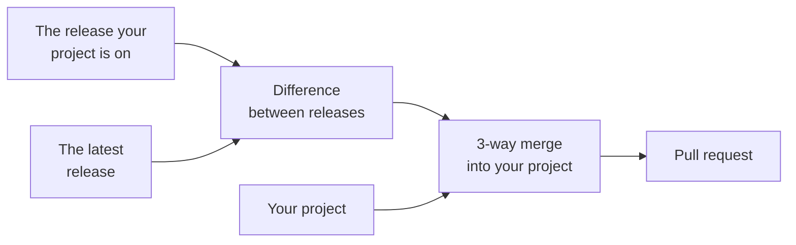

# Updating your extension

When Eddy changes, you can merge the changes into your extension: new CI jobs, tooling releases, fixes to the build and the docs it generates. Your own code and your own changes to the template stay as they are.

:::info Coming from 4.x?

An extension created from a 4.x release needs a one-off upgrade to 5.x first: its `AGENTS.md` can't fetch the update skill anymore, and the upgrade replaces `.devtools/` with the tooling package and CircleCI with GitHub Actions. [Upgrading from 4.x](upgrading-from-4x.mdx) walks you through it.

:::

## Updating with Claude Code

If you use Claude Code, ask Claude to "update scaffold" in your project. The `AGENTS.md` that Eddy generated tells it to fetch the [`update-consumer-eddy`](https://github.com/drevops/eddy/blob/main/.eddy/skills/update-consumer-eddy/SKILL.md) skill and follow it:

```bash
mkdir -p .claude/skills/update-consumer-eddy
```

```bash
curl -fsSL -o .claude/skills/update-consumer-eddy/SKILL.md \
  https://raw.githubusercontent.com/drevops/eddy/main/.eddy/skills/update-consumer-eddy/SKILL.md
```

The skill renders 2 releases with your original answers, the release your project is on and the latest one, and merges the difference between them into your project:



Your own files and your changes to the template stay as they are, apart from `scripts/eddy-tooling`, which it replaces with the release's copy. Only lines that both sides changed need a decision. The skill then builds, lints and tests the result, and opens a pull request.

A few details are worth knowing:

- **Which release.** Without a tag, the skill updates to the release with the highest version that isn't a draft or marked as a pre-release on GitHub. To update to a particular release, name its tag: `/update-consumer-eddy <tag>`.
- **Which release you're on.** The skill reads it from `extra.eddy.version` in `composer.dev.json`, which the installer and every update record, or from your last scaffold update commit. Without either, every difference between your files and the new release's comes up for a decision.
- **Adding a Drupal major.** Ask for it in the same request, such as `/update-consumer-eddy add Drupal 12`. The skill adds the major's CI jobs and badges, and makes the code changes the major needs, each in a commit of its own, even when there's no newer release to update to.
- **Permissions.** On its first run, the skill may add a few command permissions to `.claude/settings.local.json` and ask you to restart Claude Code. Run it again after the restart.

## Updating by hand

1. Download the latest release of Eddy, or the current code with **Code** → **Download ZIP** in the GitHub UI.
2. Expand it into a new directory.
3. Run `php install.php` there and repeat the answers you gave during the initial setup.
4. Create a new branch in your extension's repository.
5. Copy all files into your extension's directory, overwriting the existing ones.
6. Resolve the differences between the new files and yours, and check the release notes for breaking changes. `install.php` ran outside your repository, so keep your own branches in the workflow branch filters and your own repository in the README badges. Keep `scripts/eddy-tooling` exactly as the release ships it.
7. [Build the site](../development/building.mdx), [check coding standards](../development/coding-standards.mdx) and [run the tests](../testing/README.mdx).
8. Commit and push to your GitHub repository, and check that every CI job passes.
9. Merge the new branch into your main branch, and check that the deployment job works.

## What else stays current

- The [tooling package](../development/tooling.mdx) takes its patch releases on its own, within the `~` constraint in `composer.dev.json`. A scaffold update raises the constraint for a new minor version.
- [Renovate](renovate.mdx) keeps the npm packages, GitHub Actions and Docker images up to date between scaffold updates.
