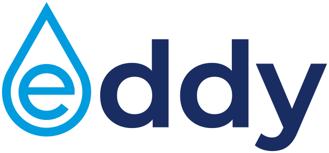

<p align="center">
  <a href="" rel="noopener">
  </a>
</p>

<h1 align="center">Eddy</h1>
<h3 align="center">Template for contributed Drupal modules and themes</h3>

<div align="center">

[](https://github.com/drevops/eddy/issues)
[](https://github.com/drevops/eddy/pulls)
[](https://github.com/drevops/eddy/actions/workflows/test.yml)
[](https://app.codecov.io/gh/drevops/eddy/branch/main)


📘 **[Read the documentation](https://eddy.drevops.com/)**

</div>

---

**Eddy** is a template for maintaining a contributed Drupal module or theme on GitHub. Start your extension from it and you get CI on GitHub Actions, a local Drupal site to develop and test against, coding standards checks, and mirroring of the code to [Drupal.org](https://drupal.org).

Eddy isn't for building websites: use [Vortex](https://github.com/drevops/vortex) for that. The 2 templates do separate jobs, and a repository uses only 1 of them.

## Features

- ⚙️ **[CI on GitHub Actions](https://eddy.drevops.com/continuous-integration)** - PHP `8.3`, `8.4` and `8.5`, and Drupal `stable` on 10, 11 and 12, plus `legacy` and `canary` tiers on 11 and 12, with code coverage on [codecov.io](https://codecov.io). The setup works with Drupal.org GitLab CI too.
- 💻 **[Local development](https://eddy.drevops.com/development)** - a Drupal site built on the PHP of your host by the same commands that CI runs, through `make` or [Ahoy](https://github.com/ahoy-cli/ahoy), with your development dependencies, suggested extensions and patches.
- 🧹 **[Coding standards](https://eddy.drevops.com/development/coding-standards)** - PHPCS, PHPStan, Drupal Rector, Twig CS Fixer, ESLint, Stylelint, CSpell and Prettier.
- 🧪 **[Tests](https://eddy.drevops.com/testing)** - PHPUnit Unit, Kernel, Functional and FunctionalJavascript tests, in a local Chrome or a Selenium container, and JavaScript tests with [Jest](https://jestjs.io/).
- 🚚 **[Deployment](https://eddy.drevops.com/deployment)** - mirroring of the code and its tags to Drupal.org, or any other git remote, once CI passes.
- 🤖 **[Renovate](https://eddy.drevops.com/updating/renovate)** - grouped pull requests that keep dependencies up to date.
- 📝 **Docs for your extension** - [README.md](README.dist.md) and [CONTRIBUTING.md](CONTRIBUTING.dist.md) templates.

Eddy tests itself the way it tests a project created from it, and deploys to [drevops/eddy_destination](https://github.com/drevops/eddy_destination) as a working example.

➡️ See the [projects using Eddy](https://eddy.drevops.com/#projects-using-eddy).

## Quick start

In a new, empty directory:

```bash
curl -fsSL https://eddy.drevops.com/install > install.php && php install.php
```

The installer downloads the latest Eddy release into the directory, then asks about your extension. Build the site with `make build` or `ahoy build`, then check it with `lint` and `test` through the same wrapper. Without a wrapper, the generated `CONTRIBUTING.md` lists the `scripts/eddy-tooling` and `vendor/bin/eddy-*` commands that do the same jobs.


To start from a download instead, expand the [latest release](https://github.com/drevops/eddy/releases/latest) into a new directory and run `php install.php` there.

➡️ [Installation](https://eddy.drevops.com/installation) walks through every step, from the download to the first deployment to Drupal.org.

## Updating

If you use Claude Code, ask Claude to "update scaffold" in your project, and it merges the latest release into your extension through a pull request. You can update by hand too.

➡️ [Updating your extension](https://eddy.drevops.com/updating) covers both, and [Upgrading from 4.x](https://eddy.drevops.com/updating/upgrading-from-4x) covers the one-off move from a 4.x release.

## Contributing

Contributions are welcome.

➡️ See [Contributing](https://eddy.drevops.com/contributing) for how to build and test the scaffold, run its self-tests, and work on the documentation.
